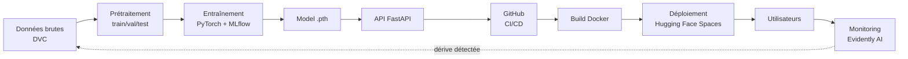

# Architecture MLOps du projet

## Vue d'ensemble

Ce projet applique un pipeline MLOps complet, organisé comme une boucle continue plutôt
qu'une suite d'étapes exécutées une seule fois. Les données brutes sont versionnées et
transformées, un modèle de deep learning est entraîné et suivi, packagé dans une API,
intégré et déployé automatiquement via CI/CD, puis surveillé en production — les
observations du monitoring reboucient vers la collecte de nouvelles données.

## Diagramme

## Détail de chaque étape

### 1. Entraînement

Le dataset (images réelles / retouchées / générées par IA) est versionné avec **DVC**,
avec un remote configuré sur Google Drive. Le script `src/data/preprocessing.py` effectue
un split stratifié train/val/test (70/15/15) et redimensionne les images en 224×224.

L'entraînement utilise **PyTorch** avec du transfer learning (backbone pré-entraîné,
fine-tuning des dernières couches). Chaque run est suivi avec **MLflow** : hyperparamètres,
courbes de loss/accuracy, métriques d'évaluation (F1-score, ROC-AUC, matrice de confusion).
Le meilleur modèle est exporté en `models/best_model.pth`.

Le prétraitement est centralisé dans `src/common/preprocessing.py`, un module partagé
utilisé à la fois par l'entraînement et par l'API, pour garantir que le modèle reçoit
exactement le même traitement en entraînement et en production (train/serve skew évité).

### 2. Code (API)

Le modèle entraîné est chargé au démarrage d'une **API FastAPI** (`api/main.py`), qui
expose un endpoint `POST /predict` acceptant une image et retournant un label
(réel / retouché / généré) avec un score de confiance. Le chargement du modèle se fait
une seule fois via un événement `lifespan`, pas à chaque requête.

### 3. CI/CD

Chaque Pull Request déclenche un workflow **GitHub Actions** qui installe les dépendances,
lance les tests unitaires (`pytest`) et vérifie le style du code. Une fois mergé sur
`main`, un second workflow prend le relais pour construire et déployer automatiquement
(voir étapes 4 et 5) — sans intervention manuelle.

### 4. Build

Le backend est packagé dans une image **Docker**, définie dans `api/Dockerfile`, incluant
toutes les dépendances système nécessaires (ex. `libgl1` pour Pillow/OpenCV). L'image est
construite et testée en local avant tout déploiement.

### 5. Déploiement

L'application est déployée sur **Hugging Face Spaces** : le backend FastAPI via le SDK
Docker, et l'interface utilisateur via une application **Gradio** (upload d'image, affichage
du résultat). Le déploiement est automatisé par la CI/CD : chaque push sur `main` pousse
le contenu vers le Space correspondant.

### 6. Monitoring

**Evidently AI** compare régulièrement un jeu de données de référence (issu de
l'entraînement) à un nouveau lot d'images, via des features extraites (dimensions,
luminosité, netteté). Un rapport HTML de data drift est généré (`monitoring/generate_monitoring_report.py`)
et accessible depuis l'API. Une dérive significative détectée à cette étape est le signal
qu'il faut collecter de nouvelles données et ré-entraîner — c'est ce qui referme la boucle
vers l'étape 1.